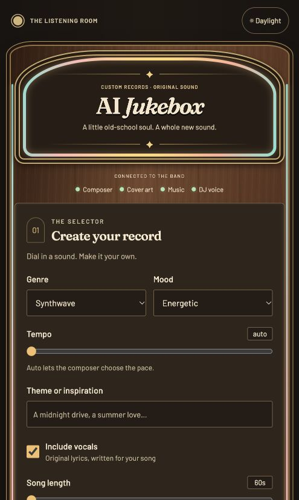
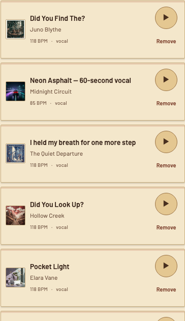

> Submission status and test evidence: [verification report](docs/verification.md).
> The team must review this report, listen to the sample songs, and complete the
> independent extracted-ZIP check before submitting.

# MBAX 6418 — Assignment 3: AI Jukebox

Build an app that (1) generates **customizable songs**, (2) generates **matching cover art**,
and (3) **plays a song collection with AI-generated spoken DJ commentary** between tracks.

Everything runs on the **class AI services — no paid APIs, no local models**.

## Class services

| Feature | Service | Endpoint | Request format |
|---|---|---|---|
| Song composing, lyrics, DJ scripts | Qwen3.6-35B-A3B-AWQ-4bit · port **9001** | `POST /v1/chat/completions` | `{model, messages, max_tokens, chat_template_kwargs: {enable_thinking: false}}` — thinking disabled (verified: ~1s replies, no hidden-reasoning truncation); JSON via `response_format` |
| Cover art | FLUX.2 klein 4B · port **9006** | `POST /v1/images/generations` | `{model, prompt, size, n}` → `data[].b64_json` (PNG) |
| Music | ACE-Step 1.5 XL Turbo · port **9007** | `POST /release_task` → `POST /query_result` → `GET /v1/audio?path=…` | submit `{prompt, lyrics, bpm, key_scale, time_signature, audio_duration, audio_format, thinking, …}`; poll `{task_id_list}` → status `1`; download via returned `file` URL |
| DJ speech | Chatterbox Multilingual V3 · port **9008** | `POST /v1/audio/speech` | `{model, input, voice, response_format, speed}` → mp3 |

API key and endpoints are read from environment / `.env` (`AIJ_API_KEY`, `AIJ_CHAT_BASE_URL`, …)
with defaults pointing at the class services. See `app/config.py`.

## How it works

A "jam" session is one customizable set:

1. **You customize**: genre, mood, tempo, theme/keywords, vocals on/off, number of songs,
   song length, DJ persona.
2. **Qwen** writes each song (lyrics with [Verse]/[Chorus] structure, a rich music caption,
   BPM/key/time signature, cover-art prompt) *and* the DJ's spoken script.
3. **ACE-Step** generates each song's audio; **FLUX** paints the matching cover art.
4. **Chatterbox** speaks the DJ persona's intro, interludes, and outro.
5. The browser plays the whole set back-to-back: intro → DJ chat → song → DJ chat → song → … → outro.

Sessions are generated in a background thread; the page polls progress and plays when ready.
Artifacts live in `sessions/<id>/` (gitignored) alongside a `manifest.json` playlist.
The player UI supports **light and dark mode** (topbar toggle; remembers your choice;
defaults to the system preference).

## Deploy from the ZIP (grader checklist)

The ZIP includes code and three class-generated sample songs with covers in `samples/`.
Credentials and user voice references are excluded. The samples are imported into
the local library on first launch, so playback is available before generation.

1. **Unzip** the submission. (No `.env`, no `sessions/` — by design.)
2. **Install Python 3.10 or newer**, then create the environment (once):
   - Windows: `python -m venv .venv`
   - macOS/Linux: `python3 -m venv .venv`
3. **Install dependencies**:
   - Windows: `.venv\Scripts\python -m pip install -r requirements.txt`
   - macOS/Linux: `.venv/bin/python -m pip install -r requirements.txt`
   For the exact versions tested on Python 3.12, use `-r requirements-lock.txt`
   instead of `-r requirements.txt`.
4. **Credentials**: create `.env` in the extracted project folder, beside
   `README.md`, by copying the supplied template:
   - Windows Command Prompt: `copy .env.example .env`
   - macOS/Linux: `cp .env.example .env`
   Edit `.env` and replace `your-class-api-key-here` with the key from
   `class-endpoints.txt`; uncomment endpoint overrides only if needed. The filename
   must be `.env`, not `.env.txt`. No shell export is required. `app/config.py`
   loads this exact file with the required `python-dotenv` dependency before the
   HTTP clients read their settings. Restart the server after editing it.
   Existing environment variables take precedence over `.env`; unset stale
   exported values when checking file-based configuration.
5. **Run**:
   - Windows: double-click `start.bat`
   - macOS/Linux: `./start.sh`
   - or directly: `python -m uvicorn app.main:app --port 8000`
   - Port override: set `AIJ_PORT` (e.g. `AIJ_PORT=8080`).
6. **Open** http://127.0.0.1:8000 — the four header lights should be green.
7. **Test the three core features** — either from the UI (pick a vibe, hit
   "Start the jam": songs + covers + DJ commentary in one set), or automated:

   ```bash
   .venv/Scripts/python scripts/smoke_test.py          # Windows
   .venv/bin/python scripts/smoke_test.py              # macOS/Linux
   ```

   For a vocal run, add `--vocals --duration 60`.

   The smoke test creates a real 1–2 song set and prints PASS/FAIL per feature:
   song generation (ACE-Step), cover art (FLUX), DJ commentary (Chatterbox),
   and playlist order. Exit code 0 = all pass.

## Run (developer shorthand)

```bash
python -m venv .venv
.venv/Scripts/python -m pip install -r requirements.txt
.venv/Scripts/python -m uvicorn app.main:app --port 8000
```

Open http://localhost:8000 — status lights in the header show whether all four
class services are reachable, and `scripts/smoke_test.py` automates the
three-feature verification (see "Deploy from the ZIP").

## Layout

```
app/
  main.py     FastAPI routes + service health
  config.py   endpoints / credentials (env-overridable, class defaults)
  clients.py  verified HTTP clients for the 4 class services
  songs.py    Qwen song composer (customization -> production spec)
  art.py      FLUX cover-art generation
  djs.py      DJ script writing (Qwen) + speech (Chatterbox)
  library.py  persistent track library (index + copied artifacts, gitignored)
  jukebox.py  background session builder (playlist manifest)
  static/     retro cabinet player UI (index.html, retro.css, app.js)
    fonts/    locally hosted Barlow + Fraunces fonts and OFL licenses
scripts/
  smoke_test.py   automated three-feature verification (grader-friendly)
start.bat / start.sh   one-command launchers (venv + install + run)
sessions/     generated audio/art/playlists (gitignored)
```

## Feature checklist (rubric mapping)

| Requirement | Where it lives |
|---|---|
| Choose a song's style, mood, duration | controls panel (genre · mood · tempo · theme · song length · vocals) + "Generate one song" button / `POST /api/custom-song` |
| Generate playable audio with ACE-Step | every song is rendered by ACE-Step (9007) — see `app/clients.py:generate_song` |
| Add it to the library | every generated song is auto-added to the persistent library (`app/library.py`, index in `library/tracks.json`); browsable & playable in the Library panel |
| Instrumental + vocal tracks, AI lyrics for vocal | "Vocals" toggle; vocal tracks get full Qwen-written lyrics with section tags, shown in the player (🎤 Lyrics) |

## Retro cabinet interface

The interface draws on vintage jukebox materials: walnut grain, brass trim,
cream record labels, and coral/amber/turquoise fluorescent tubing. Fraunces is
used for display headings and Barlow for readable controls. Fonts are bundled
locally under their SIL Open Font Licenses; no font CDN is needed at runtime.
The Daylight / After hours switch persists the light/dark preference.

The desktop layout separates creation, playback, and the saved collection.
Tablet and mobile layouts reflow without horizontal scrolling. Keyboard focus,
a skip link, named playback buttons, live status announcements, accessible
progress values, and reduced-motion support are included.

Previous / Pause–Resume / Next controls step through individual playlist entries,
including DJ segments as well as songs, without wrapping at the set boundaries.
The seek bar has a visible circular playhead during loaded audio playback and
supports clicking and keyboard arrows/Home/End. Generation progress does not
show an audio playhead.

### Short vocal songs

Vocal songs have a visible 60-second minimum in both the UI and API;
instrumental clips still allow 10 seconds. Switching vocals on raises a shorter
slider selection to 60 seconds before submission, with an explanation beside
the control. Direct API requests for shorter vocal songs receive a validation
error rather than silently changing their duration.

At 60 seconds, songs are composed as compact, hook-first performances with a
conservative budget of 1.2 sung words per second. Captions request singing from
the first beat without an instrumental intro, solo or long outro. Before
rendering, the app takes a contiguous excerpt beginning at the first chorus/hook
and removes instrumental sections, preserving the subsequent verse/chorus order
and section labels rather than sorting all choruses ahead of verses. Longer songs retain
their full arrangement. Real-audio checks found that prompt changes alone did
not reliably produce recognizable lyrics in 10–30-second generations, whereas
both tested 60-second generations contained singing. Music generation remains
probabilistic; the minimum and arrangement controls are safeguards, not a
guarantee of exact vocal timing or lyric fidelity. Existing audio is unchanged.

The lyric display uses the music service's returned lyric sheet when available,
falling back to the submitted sheet. The original submitted text is retained as
`written_lyrics`, alongside `lyrics_source`, in new session/library entries.
These are lyric sheets, not audio transcriptions or timestamped karaoke lyrics:
the generator can still repeat, omit or alter words. Existing recordings and
their older saved lyric sheets are not rewritten automatically.

### Title and artist variety

Naming forms rotate independently across genres: titles may be a single word,
a question, a conversational fragment, a concrete detail, or a plainspoken
sentence. Fictional artist identities vary between solo performers, mononyms,
duos, and bands instead of always using the same adjective-noun pattern.

The composer sees recent titles/artists and frequently reused vocabulary from
the whole collection, not only the chosen genre. A deterministic check rejects
exact/near duplicates, superficial punctuation/plural/numbered variants, and
overworked name words. Artist identities also avoid previously used distinctive
name words/surnames, not just identical full names. Listener-requested subject
words can still appear in titles. Accepted names are reserved before audio
generation so pending tracks in a set and simultaneous requests also inform
later drafts. Saved collection names are reloaded after restarts. Form rotation
is process-local, as are reservations for the latest 200 accepted specs. An
accepted name from a subsequently failed session remains reserved until eviction
or restart.

Conflicting names trigger up to three complete composition drafts, preserving
the connection between title, lyric hook, and cover scene. There is no post-hoc
number suffix or random rename of finished audio. Persistent conflicts produce
an explicit error instead of silently accepting a duplicate. Existing songs
and artist names are never renamed by this change. These are lexical checks,
not a guarantee of semantic uniqueness or a worldwide artist-name search.

### Cover-art variety

Every new song receives a varied visual brief before the songwriter creates
its cover prompt: palette, medium, narrative approach, and a matched composition
and richness treatment. Compositions rotate between cinematic worlds, surreal
environments, intricate illustrations, environmental portraits, still-life
tableaux, landscapes, action scenes, photomontage, and bold graphic designs.
Most develop layered scenes, lighting, textures and secondary story details;
the occasional more restrained graphic treatment provides contrast. Covers are
not all reduced to isolated objects or flat icons on empty backgrounds.

Palette, medium, composition and approach use shuffled pools per genre, shared
across sets and single-song requests. Richness stays coupled to its composition
so their instructions agree. Choices are exhausted before reuse, and reshuffling avoids
immediate repeats. The pools are not tied to genre stereotypes: synthwave can
receive a linocut, monochrome photograph, textile illustration, or oil painting
instead of always getting a pink/blue neon cityscape.

The songwriter grounds the scene in the song's theme/story, and the image
renderer also receives the assigned visual brief. The brief and cover prompt
are saved with newly generated session/library tracks. Existing covers are not
changed. Shuffle history is process-local; restarting begins a fresh random
order. Visual variety is guided, not a guarantee that every AI image is unique.

### Removing collection tracks

Use a song's **Remove** action and confirm its title. Removal deletes the saved
collection entry and that entry's copied audio/cover files, but preserves the
original generated DJ-session files. Cancel leaves the song untouched. Removing
the currently selected library song stops that playback; other songs and session
playlists are not deleted.

### Regression tests

With the app running on port 8003 (or set `AIJ_TEST_URL` to its URL):

```bash
uv pip install --python .venv/bin/python -r requirements-dev.txt
.venv/bin/python -m playwright install chromium
.venv/bin/python -m unittest discover -s tests -v
```

Art-direction unit tests check variation, shuffle boundaries, concurrency,
and propagation into composer, renderer, and saved metadata. Collection-removal
tests use isolated temporary directories, never the real collection.

The browser tests use explicitly intercepted API fixtures for deterministic
UI-state checks and a silent WAV for real browser pause/resume testing; they
do not call the AI services. Use `scripts/smoke_test.py --base URL` separately
for real end-to-end music, cover art, and DJ generation.

## Credentials & safeguards

- **Credentials are server-side only.** Copy `.env.example` to `.env` and fill in
  `AIJ_API_KEY`; the app explicitly loads this project-root file before constructing
  its server-side HTTP clients. No shell export is needed. `.env` is
  gitignored — never commit it, and never put a real key in code, docs, logs,
  or browser scripts. The UI talks to this server, which holds the key; the
  browser never sees it.
- **Voice references:** optional MP3/WAV input (1–60 seconds, up to 10 MB) customizes
  the DJ for a jam. The server holds reference bytes only while building that jam
  and sends them to the class Chatterbox endpoint as `ref_audio`. They are never
  written to disk, returned in status, or included in the ZIP. Clear the file input
  to use the default voice. Chatterbox validates the recording duration and decoding.
- Runtime output lives in gitignored `sessions/` and `library/`. The three selected
  class-generated submission examples are explicitly included in `samples/`.
- **No third-party music, lyrics, cover art, or voice samples are bundled.**
  The bundled samples and newly generated music, covers, and DJ clips use the class services.

## Git workflow

Work happens on personal branches (e.g. `LN-Branch`); `main` is kept stable and only
changes via an agreed merge/PR. Nothing here is pushed anywhere without approval.

## Vocal-generation fix

The music client now sends `vocal_language` explicitly and disables ACE-Step caption
rewriting and language inference (`use_cot_caption=false`, `use_cot_language=false`).
Qwen already supplies a vocal arrangement and original lyrics; preserving those
instructions avoids a second model rewriting the requested arrangement. This is a
mitigation for missing singing, not a guarantee of lyric-perfect audio. Vocal requests
with no actual words (including tag-only lyrics) fail before audio generation. Existing
instrumental recordings cannot gain vocals retroactively; generate a new vocal song.
See the [ACE-Step API documentation](https://github.com/ace-step/ACE-Step-1.5/blob/main/docs/en/API.md)
for these options. Keep Include vocals checked and select at least 60 seconds.

## Design judgment

**Choice: preserve Qwen's vocal arrangement instead of letting ACE-Step rewrite it.**
ACE-Step accepts CoT caption/language options that re-derive the musical brief
from the prompt. We disable them (`use_cot_caption=false`, `use_cot_language=false`)
and send the composer's singing instructions, arrangement and lyrics plus an
explicit `vocal_language` unchanged. Evidence: the three bundled 60-second vocal
samples, generated through this path, all produced recognizable lyric phrases
under an independent transcription check ("Pocket Light", "Did You Look Up?",
"I held my breath for one more step" — see `docs/verification.md` for excerpts).
Caveat: transcription showed word substitutions and repeated lines, so this is a
mitigation, not a proof of lyric-perfect audio for every generation.

**Limitation investigated: short vocal clips come back instrumental.**
The original reported bug was "no singing." Testing showed 10–30-second
generations do not reliably contain recognizable vocals regardless of prompt,
while both 60-second tests did (see "Short vocal songs"). Lesson: the safest
guarantee is structural, not prompt-level — the app now enforces a 60-second
minimum for vocal tracks in both the UI and the API, and composes short vocal
clips as hook-first arrangements. A second failure investigated (DJ scripts with
the wrong number of spoken intros) is caught by validating the script structure
and retrying up to three times, so an invalid queue is never marked ready.

## Samples and interface evidence

### How the sample songs, lyrics, and covers were generated

The three bundled samples are original class-service output, not third-party
media. One click of **Start the jam** in the app produced all of them; the flow
was:

1. **Options** — pop, happy, 60 seconds, vocals on, theme "small moments of
   courage on the way home".
2. **Composition (Qwen, port 9001)** — the songwriter prompt turned those options
   into each song's production spec: a title and fictional artist, original
   lyrics with [Chorus]/[Verse] structure, a music caption (style, mood, BPM,
   key), and a cover-art prompt grounded in the song's story.
3. **Audio (ACE-Step, port 9007)** — each spec, including the full lyrics, was
   submitted to the text-to-music service (`vocal_language=en`, caption
   rewriting disabled) and rendered as a 60-second MP3.
4. **Covers (FLUX, port 9006)** — each song's cover prompt was sent to the
   image service and saved as a PNG; every cover is unique to its song's theme
   (palette, medium, composition and art direction are recorded per track).
5. **Verification** — an independent transcription check recovered recognizable
   lyric phrases from all three songs (excerpts in `docs/verification.md`), and
   the covers were visually checked. Exact lyric fidelity remains probabilistic
   — the team's listening review is the final check.

Every detail of the above — per-service provenance, options, per-track lyrics,
cover prompts, BPM/key, and seeds — is recorded in `samples/manifest.json`
(`source_session` stores the generating session id). To replace the samples,
generate a completed three-song jam and run
`python scripts/export_samples.py SESSION_ID`, then listen to all three.

Samples contain generated media only.




## Final submission steps

Review [the verification report](docs/verification.md) and [the retained starter
prompt](docs/starter-prompt.md). Have a teammate extract a fresh ZIP, follow the setup
instructions using class credentials, and record their actual results. Each teammate
must contribute and review a teammate's work; this patch does not establish that.
Push the reviewed version through the team's GitHub issue/PR process, record the
submitted commit ID, and download the ZIP from GitHub for that same commit. Submit
that link, commit ID, and GitHub ZIP together. A local preview ZIP is not evidence
that the same version has been published on GitHub.

### Verify file-based configuration

Run `python -m unittest discover -s tests -p test_config.py -v` after installing
`requirements.txt`. These tests copy the real template into an isolated project,
fill it with dummy values, clear inherited `AIJ_*` variables, and start a fresh
Python process from another folder. They verify the key, all four endpoint URLs,
and the server-side Authorization header; check environment-variable precedence;
and ensure an unrelated working directory's `.env` is ignored. They never read,
print, or transmit your real credentials.
